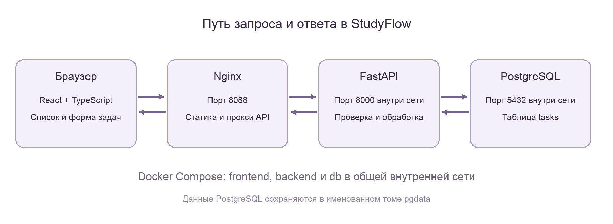

# Архитектура StudyFlow

Браузер загружает собранный React-интерфейс из Nginx. Запросы `/api/` тот же Nginx
передаёт в FastAPI. Сервер читает и изменяет PostgreSQL через SQLAlchemy.
В Compose наружу опубликован только Nginx: `127.0.0.1:8088`.

## Почему одна таблица

Для личного списка заданий достаточно таблицы `tasks`. Предмет — строка в записи,
а список предметов строится по имеющимся заданиям. Это позволяет сразу записать
новую дисциплину, но одинаковые предметы с разным написанием будут различаться.
Отдельного справочника и редактирования предметов в этой версии нет.

У задачи есть `id`, `title`, `subject`, `description`, `due_date`, `priority`,
`status`, `created_at` и `updated_at`. Статусы — `todo`, `in_progress`, `done`;
приоритеты — `low`, `medium`, `high`. Их допустимые значения проверяются и API,
и ограничениями базы. Время создания и изменения записывает сервер.

Срок — календарная дата без часов. Ввести прошедшую дату можно: иногда нужно
добавить уже пропущенную работу. Выполнение снимает отметку просрочки, не меняя
саму дату. Повторяющиеся названия разрешены.

## HTTP API

| Запрос | Назначение |
| --- | --- |
| `GET /api/tasks` | Получить список. Параметры: `subject`, `status`, `q` |
| `POST /api/tasks` | Создать задачу; ответ 201 |
| `GET /api/tasks/{id}` | Получить одну задачу |
| `PUT /api/tasks/{id}` | Сохранить все редактируемые поля |
| `PATCH /api/tasks/{id}/status` | Изменить только статус |
| `DELETE /api/tasks/{id}` | Удалить задачу; ответ 204 без тела |
| `GET /health` | Проверить соединение с базой и узнать метку версии |

Пустое название, неизвестный статус и несуществующая дата возвращают 422.
Отсутствующий идентификатор — 404. Пробелы по краям строк удаляются; служебные поля
нельзя передать при создании. `/health` выполняет `SELECT 1`, поэтому проверку
таблицы заданий при обновлении дополняет запрос `/api/tasks`.

## Что остаётся на клиенте

Список небольшой, поэтому интерфейс загружает задания целиком. Поиск, предмет,
статус и сроки можно совместить без нового запроса. После сохранения список
обновляется данными из ответа API. При ошибке сервера введённая форма сохраняется,
а статус задания не меняется заранее.

Регистрации нет, следовательно, все запросы относятся к одному личному списку.
Для публичного сервера понадобятся авторизация и привязка записей к пользователю.
Пагинация и напоминания в текущую версию не входят.
